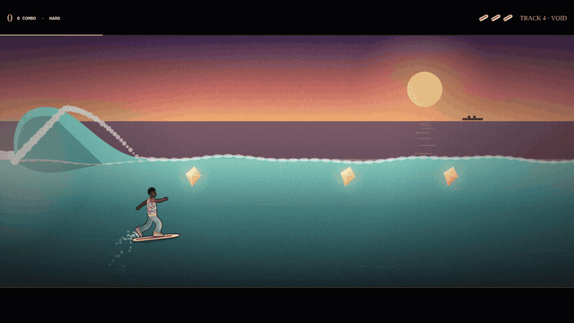
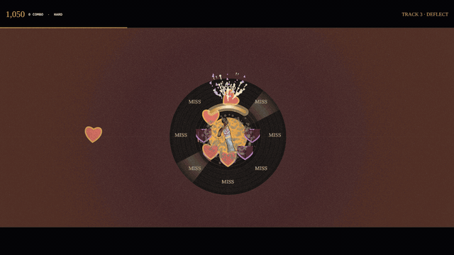
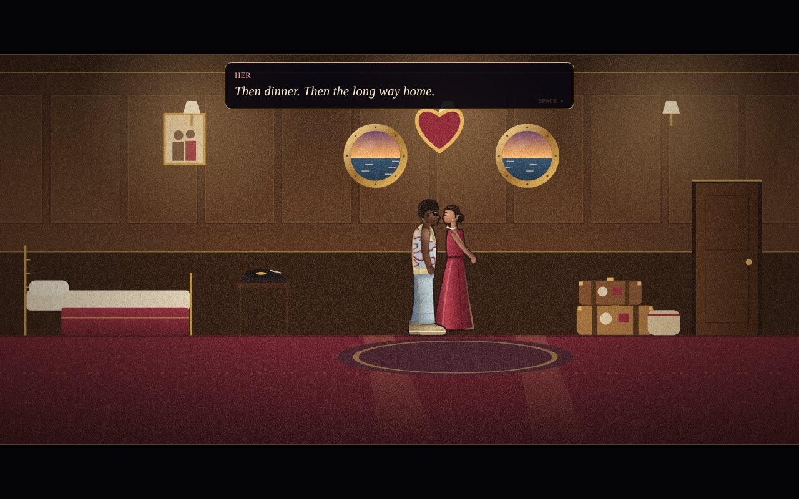
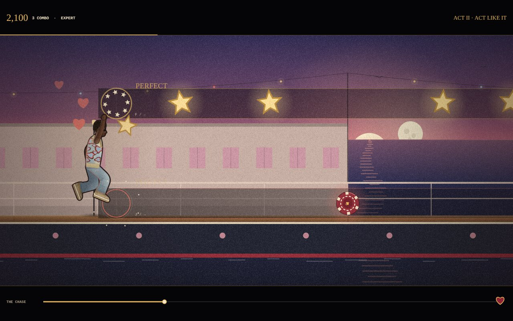
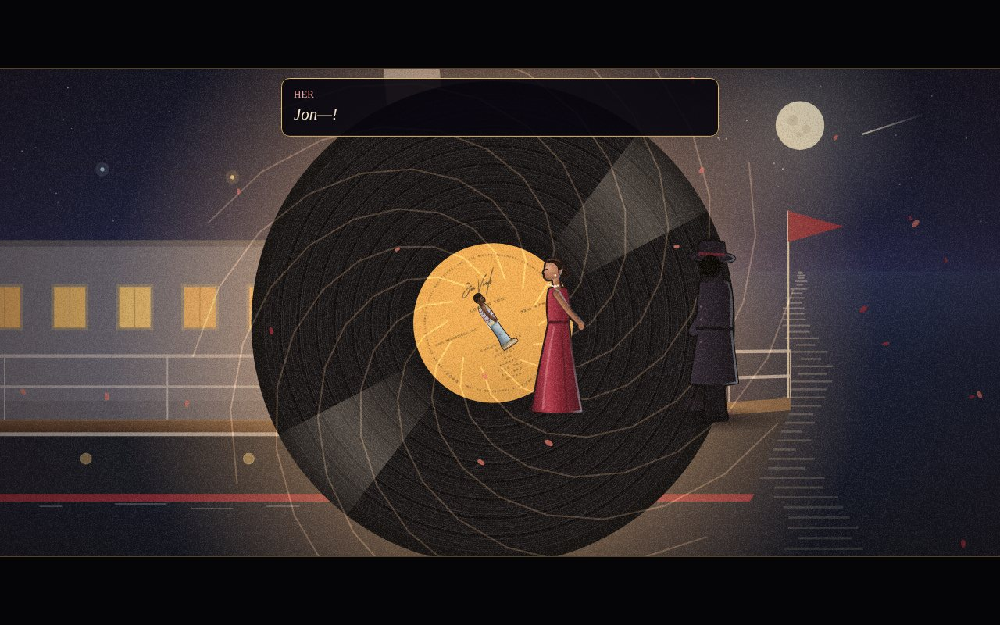
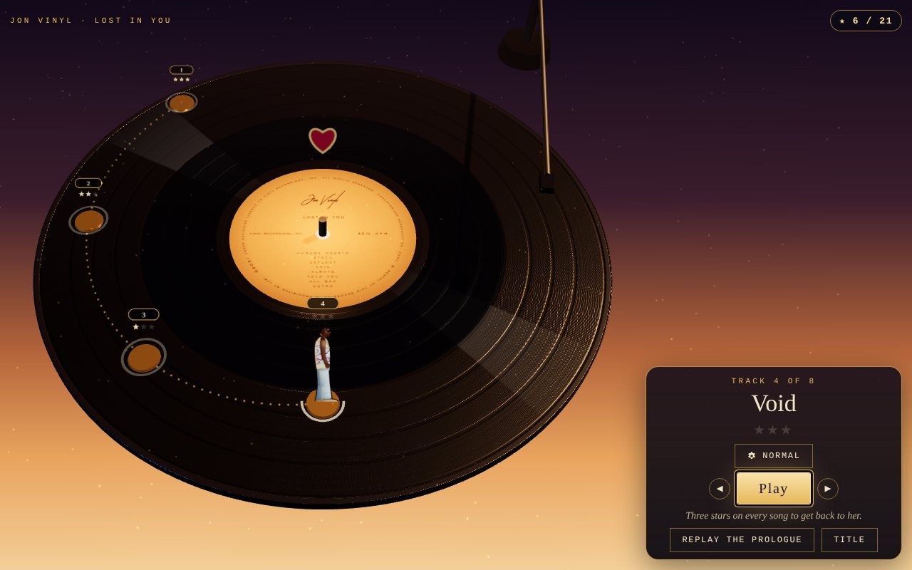
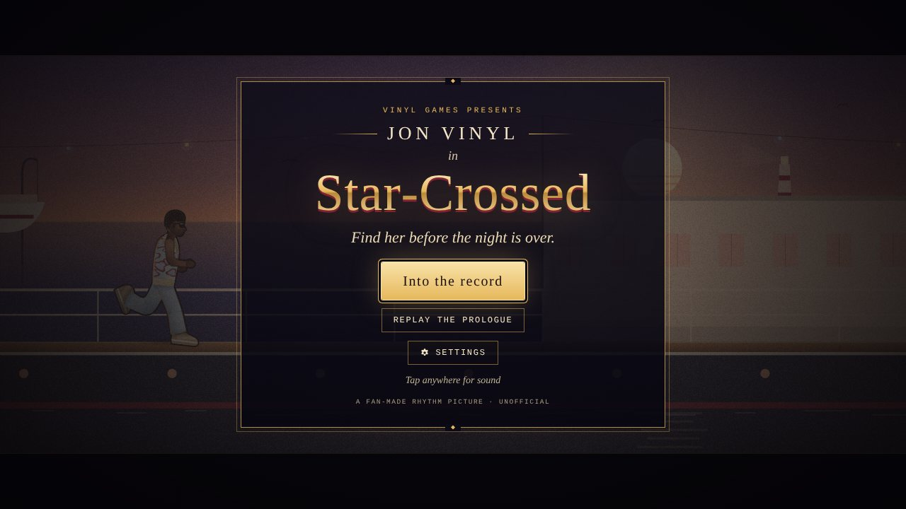

# Star-Crossed

**A fan-made rhythm game in the style of an old-Hollywood picture, set to the music of Jon Vinyl.**
It runs in the browser on desktop and phones, built with plain HTML5 canvas, Web Audio and Three.js. No engine, no framework.

> 🚧 **Work in progress.** The prologue, the record map and two of the album's seven songs are playable. The rest of
> the songs and the ending are still being built, one at a time. See [Status](#status).

<p align="center">
  
  
</p>

Jon and the girl he loves have finally slipped away together on an ocean liner. Then a faceless stranger steps out of
the casino and takes her. You chase them across the ship on the beat, win her back at the bow, and accept the
stranger's "no hard feelings" gift: the album *Lost in You*. Jon slides the record out of its sleeve and it pulls him
in. To get home, he has to beat every song on it.

<p align="center">
  
  
  
</p>

## What's in it

| Part | What you do |
|---|---|
| **Prologue: Star-Crossed** | A walkable cabin (tap her, the door, the turntable…), a cutscene on deck, then the chase: jump what's on the deck (the snare and hi-hats) and slide under what hangs overhead (the kick), with passengers cheering him on. Every obstacle reaches Jon exactly on its drum hit, and what he does always matches the judgement: a hit clears it, a miss crashes into it. No tutorial screen: the first jump and slide stop the song and wait for you. The score earns a review, but the story always goes on. |
| **The record** | A 3D level map made to match the real vinyl pressing: one band of grooves per song, sized to the song's length, walked from the rim toward the label like a record plays. |
| **Track 3: Deflect** | Jon stands on the label while hearts (rhythm-guitar strums) and heartbreaks (lead-guitar notes) fly in; turn the shield to meet each one. On a computer they come from all eight directions (inspired by *Beatblock*). On a phone they come in from ahead along eight paths, lead down the left and rhythm down the right, and the shield follows your thumb. |
| **Track 4: Void** | A sunset surf. Hold to climb the wave, let go to carve, and collect gems that sit on the drum hits. Ride off the lip to fly, hold in the air to backflip, and land flat or wipe out (three boards). |

Each album song scores up to three stars. Beating every song opens the Outro, the way home; three stars on all of them
adds the full ending. Expert+ unlocks per song with three stars on Expert.

## Status

This is a work in progress, built one song at a time.

- **Playable now:** the prologue (cabin, deck, the chase, the bow and the pull into the record), the 3D record map with
  progress and stars, Track 3 *Deflect* and Track 4 *Void*, results with coaching, and Settings for level and timing.
- **Still to come:** Tracks 1 *Chrome Hearts*, 2 *Stacy*, 5 *Always*, 6 *Told You* and 7 *All Bad*; the Outro escape
  and the full ending; unlock animations on the record; and more variety inside each song as it plays.

<p align="center">
  
  
</p>

## How it works

- **Charts come from the music, not a grid.** Each song is split into stems (drums into kick, snare, hi-hat and
  more with drumsep, plus Demucs, and lead and rhythm guitar for Deflect). `tools/find_hits.py` finds the attack of
  every hit on a 2 ms envelope, and the chart scripts place notes on those exact moments. The prologue's groove is
  swung with triplet kicks, so snapping to a 16th-note grid would put notes where nothing plays.
- **The mix follows your riding.** Void plays as two layers, the drums and the rest of the song, mixed live. The
  drums fill in as your combo builds and drop back when you miss. In the air the bass falls away, then slams back in
  when you land. A wipeout pulls the whole song underwater.
- **Results coach you.** After a song the card names one thing that went well and one thing to try ("most of what got
  through came from the left"), and offers the next level up after a near-perfect run.
- **Charts are checked for playability.** In Void, a gem is only kept if a rider can physically get there from the one
  before. Every jump follows the same arc, so the chart lines gems up along it.
- **Timing is honest.** The game reads the audio clock (`AudioContext.getOutputTimestamp`, with a latency fallback),
  so notes line up with what you *hear*, Bluetooth delay included. A tap-along sound check sets a personal offset, and
  the results screen offers to fix it from your median error.
- **Everything is drawn in code.** Characters, the ship, the cabin, the waves and the skies are painted with the
  Canvas 2D API in layered passes. The only images are the real album cover and record label.
- **One build, three shapes.** `tools/build.py` turns `game/` into a web build, an itch.io zip, and a single
  self-contained HTML file with the audio and Three.js embedded. That file plays offline, straight from disk.
- **Tested by bots.** Playwright scripts play every level at desktop and phone sizes: they walk the cabin, play the
  chase, deflect hearts, surf, flip and wipe out on purpose. Each run saves screenshots for review.

## Run it

```bash
npm install                 # Playwright, for the tests
pip install -r requirements.txt   # only needed to re-chart songs; ffmpeg too
npm run build               # writes dist/: web build, itch.io zip, single-file HTML
npm run serve               # then open http://localhost:8765/dist/web/
npm test                    # play-tests (keep `npm run serve` running); screenshots land in test-output/
```

**Controls.** Phone: swipe up (or tap left) to jump, swipe down (or tap right) to slide (Deflect: slide your thumb
across to move the shield; Void: hold anywhere). Computer: `↑` `Space` `F` to jump, `↓` `J` to slide (Deflect: mouse or arrows; Void:
hold any key).
Level and timing live in **Settings**.

## Project layout

| Path | What it is |
|---|---|
| `game/src.html` | The game: rendering, audio, story, prologue, menus. |
| `game/chase.js` | The prologue's chase: obstacles, the slide, passengers cheering, first-time lessons. |
| `game/map.js` | The 3D record map (Three.js). |
| `game/deflect.js` | The album-song level engine, results and stars, and the Deflect level. |
| `game/surf.js` | The Void level: wave physics, launches, flips, wipeouts. |
| `tools/` | `find_hits.py`, `find_guitar_hits.py` (onset detection) → `make_charts.py`, `make_deflect_chart.py`, `make_surf_chart.py` → `build.py`. `capture_media.js` makes the GIFs above. |
| `songs/<song>/` | Each song's audio, separated stems, detected hits (`analysis/`) and `chart.json`. |
| `album/lost-in-you/` | Tracklist and song lengths, the album cover and the record label. |
| `tests/` | Playwright play-tests; `run-all.js` runs them all. |
| `vendor/` | Three.js r169 (MIT). |

## How this was built

I designed and directed the game: the story, the look, how each song should feel to play, and what stayed or went
after each playtest. The code was written with [Claude Code](https://claude.com/claude-code) as an AI
pair-programmer. [`CLAUDE.md`](CLAUDE.md) is the running design document from that collaboration. It records every
decision, the feedback that changed the game (controls rejected on phones, a redesign that was rolled back), and the
hard-won timing rules.

## Credits

Fan-made and unofficial, not affiliated with Jon Vinyl. Music, album cover and label art © Jon Vinyl, used here for a
non-commercial fan project. Three.js © its authors, MIT licence (`vendor/three.LICENSE`).
